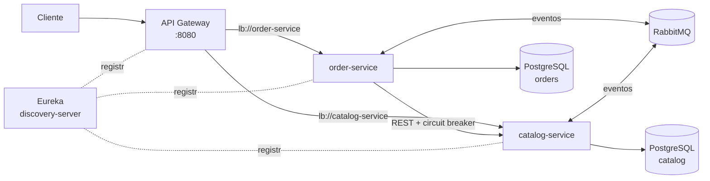
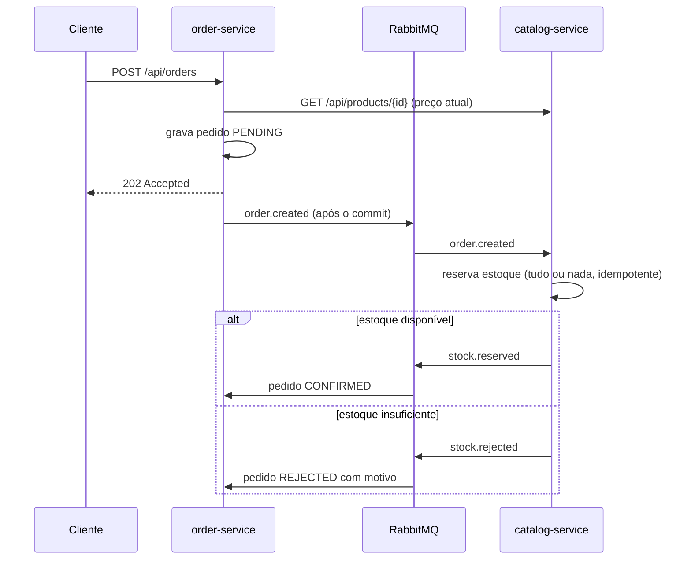

# E-commerce Microservices


Plataforma de e-commerce em **arquitetura de microsserviços** com Spring Cloud: service discovery, API Gateway, comunicação síncrona com circuit breaker e comunicação assíncrona orientada a eventos com RabbitMQ.

O fluxo de pedido é implementado como uma **saga coreografada**: o pedido nasce `PENDING`, o catálogo reserva o estoque de forma assíncrona e responde com um evento que confirma ou rejeita o pedido. Nenhum serviço acessa o banco do outro.

## Arquitetura



### Saga do pedido



## Serviços

| Serviço | Porta | Responsabilidade |
|---|---|---|
| `discovery-server` | 8761 | Registro de serviços (Eureka Server) |
| `api-gateway` | 8080 | Ponto único de entrada, roteamento com balanceamento de carga (Spring Cloud Gateway) |
| `catalog-service` | 8081 | Produtos e estoque; consome `order.created` e publica `stock.reserved` / `stock.rejected` |
| `order-service` | 8082 | Pedidos; consulta o catálogo via REST com Resilience4j e conduz a saga |

## Decisões técnicas

- **Database per service**: cada serviço tem o próprio banco e as próprias migrations (Flyway)
- **Eventos publicados após o commit** (`@TransactionalEventListener(AFTER_COMMIT)`), sem eventos de transações que falharam
- **Idempotência**: o catálogo registra pedidos já processados, então uma mensagem reentregue não baixa o estoque duas vezes
- **Reserva tudo ou nada**: se um item não tem estoque, nenhum item do pedido é reservado
- **Lock otimista** (`@Version`) nos produtos contra atualizações concorrentes
- **Circuit breaker** (Resilience4j) na chamada ao catálogo: com o catálogo fora do ar, a API responde `503` em vez de travar
- **Retry + Dead Letter Queue** no consumidor: mensagens com erro vão para `catalog.order-created.dlq` após 3 tentativas
- **Contratos de evento duplicados de propósito**: cada serviço tem a própria cópia dos records, sem biblioteca compartilhada acoplando os deploys
- Imagens Docker multi-stage com usuário sem privilégios

## Stack

Java 21 · Spring Boot 4.1 · Spring Cloud 2025.1 (Gateway, Netflix Eureka, LoadBalancer, CircuitBreaker Resilience4j) · Spring Data JPA · Hibernate · PostgreSQL 17 · Flyway · RabbitMQ 4 (Spring AMQP) · JUnit 5 · Mockito · Testcontainers · Docker Compose · GitHub Actions

## Como executar

```bash
docker compose up --build
```

Aguarde os serviços aparecerem no Eureka (http://localhost:8761). Depois:

```bash
# Produtos (via gateway)
curl localhost:8080/api/products

# Cria um pedido: responde 202 com status PENDING
curl -X POST localhost:8080/api/orders -H "Content-Type: application/json" \
  -d '{"customerEmail":"ana@email.com","items":[{"productId":1,"quantity":2}]}'

# Consulta o pedido: CONFIRMED ou REJECTED (com o motivo)
curl localhost:8080/api/orders/1
```

Painel do RabbitMQ: http://localhost:15672 (guest / guest).

## Testes

```bash
./mvnw verify
```

- `catalog-service`: `StockReservationIntegrationTest` usa PostgreSQL e RabbitMQ em containers e valida reserva, rejeição por falta de estoque e idempotência com mensagem duplicada
- `order-service`: `OrderSagaIntegrationTest` valida o fluxo `PENDING → CONFIRMED`, `PENDING → REJECTED` e o `503` quando o catálogo está indisponível; `OrderTest` cobre as regras do domínio

O GitHub Actions roda todos os testes e gera a imagem Docker de cada serviço.

## Autor

**André Souza** · Desenvolvedor Java Back-end
[LinkedIn](https://www.linkedin.com/in/andre-souza-ti) · [GitHub](https://github.com/AndreSouzaTI)
