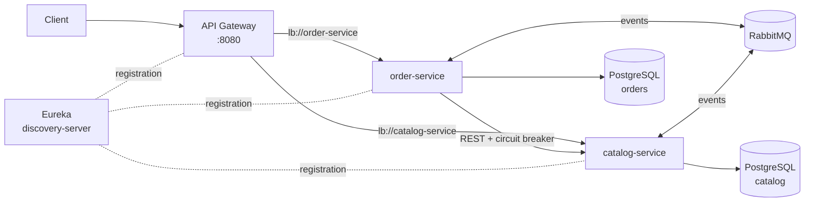
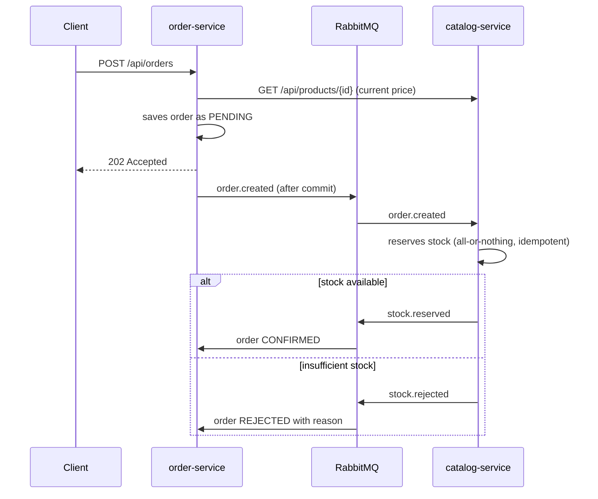

# E-commerce Microservices


E-commerce platform built on a **microservices architecture** with Spring Cloud: service discovery, an API Gateway, synchronous communication protected by a circuit breaker, and asynchronous event-driven communication with RabbitMQ.

The order flow is implemented as a **choreographed saga**: an order starts as `PENDING`, the catalog reserves stock asynchronously and replies with an event that confirms or rejects the order. No service accesses another service's database.

## Architecture



### Order saga



## Services

| Service | Port | Responsibility |
|---|---|---|
| `discovery-server` | 8761 | Service registry (Eureka Server) |
| `api-gateway` | 8080 | Single entry point, load-balanced routing (Spring Cloud Gateway) |
| `catalog-service` | 8081 | Products and stock; consumes `order.created` and publishes `stock.reserved` / `stock.rejected` |
| `order-service` | 8082 | Orders; calls the catalog over REST with Resilience4j and drives the saga |

## Technical decisions

- **Database per service**: each service owns its database and its migrations (Flyway)
- **Events published after commit** (`@TransactionalEventListener(AFTER_COMMIT)`), so failed transactions never emit events
- **Idempotency**: the catalog records processed orders, so a redelivered message never deducts stock twice
- **All-or-nothing reservation**: if any item is out of stock, no item in the order is reserved
- **Optimistic locking** (`@Version`) on products against concurrent updates
- **Circuit breaker** (Resilience4j) on the catalog call: when the catalog is down, the API returns `503` instead of hanging
- **Retry + Dead Letter Queue** on the consumer: failing messages go to `catalog.order-created.dlq` after 3 attempts
- **Event contracts duplicated on purpose**: each service keeps its own copy of the records, with no shared library coupling deployments
- Multi-stage Docker images running as a non-root user

## Tech stack

Java 21 · Spring Boot 4.1 · Spring Cloud 2025.1 (Gateway, Netflix Eureka, LoadBalancer, CircuitBreaker Resilience4j) · Spring Data JPA · Hibernate · PostgreSQL 17 · Flyway · RabbitMQ 4 (Spring AMQP) · JUnit 5 · Mockito · Testcontainers · Docker Compose · GitHub Actions

## Getting started

```bash
docker compose up --build
```

Wait for the services to show up in Eureka (http://localhost:8761). Then:

```bash
# Products (through the gateway)
curl localhost:8080/api/products

# Create an order: returns 202 with status PENDING
curl -X POST localhost:8080/api/orders -H "Content-Type: application/json" \
  -d '{"customerEmail":"ana@email.com","items":[{"productId":1,"quantity":2}]}'

# Check the order: CONFIRMED or REJECTED (with the reason)
curl localhost:8080/api/orders/1
```

RabbitMQ management UI: http://localhost:15672 (guest / guest).

## Tests

```bash
./mvnw verify
```

- `catalog-service`: `StockReservationIntegrationTest` uses containerized PostgreSQL and RabbitMQ to verify reservation, rejection due to insufficient stock, and idempotency with a duplicated message
- `order-service`: `OrderSagaIntegrationTest` verifies the `PENDING → CONFIRMED` and `PENDING → REJECTED` flows and the `503` when the catalog is unavailable; `OrderTest` covers the domain rules

GitHub Actions runs all tests and builds a Docker image for each service.

## Author

**André Souza** · Back-end Software Engineer (Java)
[LinkedIn](https://www.linkedin.com/in/andre-souza-ti) · [GitHub](https://github.com/AndreSouzaTI)
